## 

## 

  
   
  
   
  

## 

<table>
  <tbody>
    <tr>
      <td width="50%" valign="top">  
               
        
      </td>
      <td width="50%" valign="top">  
            
        
      </td>
    </tr>
    <tr>
      <td width="50%" valign="top">  
         
        
      </td>
      <td width="50%" valign="top">  
         
        
      </td>
    </tr>
    <tr>
      <td width="50%" valign="top">  
             
        
      </td>
      <td width="50%" valign="top">  
         
        
      </td>
    </tr>
    <tr>
      <td width="50%" valign="top">  
           
        
      </td>
      <td width="50%" valign="top">  
           
        
      </td>
    </tr>
  </tbody>
  <tfoot>
    <tr><td colspan="2" align="center"></td></tr>
  </tfoot>
</table>

## 

 

 

 

 

 

 

## 

## 

  

## 

  
  

## 

&nbsp;
&nbsp;
&nbsp;

  

