## `$ whoami`

Systems Engineer and **Automation & BI Analyst at WTW** who also does **DevOps on AWS with Terraform**, with experience in finance and insurance (Bancolombia, WTW). I find manual, repetitive processes and replace them with dashboards and automations that run on their own: **Python, SQL, Power BI, C# (RPA) and Azure**.

Lately I build **AI-powered systems with Claude**: LLMs as decision components with validated structured output, evaluated with real statistics instead of vibes, and shipped end to end with **Claude Code**.

## `$ ls ~/things-i-love`

  
   
  
   
  

## `$ cat tech-stack.yaml`

<table>
  <thead>
    <tr><th colspan="2" align="left"><code>angel@medellin:~$ cat tech-stack.yaml</code></th></tr>
  </thead>
  <tbody>
    <tr>
      <td width="50%" valign="top"><code>├─ ▤ data_bi:</code>  
               
        <code>Python · Pandas · NumPy · Power BI · DAX · Power Query · Excel</code>
      </td>
      <td width="50%" valign="top"><code>├─ ⇄ data_engineering:</code>  
            
        <code>Azure Data Factory · Databricks · Spark · Airflow</code>
      </td>
    </tr>
    <tr>
      <td width="50%" valign="top"><code>├─ ⛁ databases:</code>  
         
        <code>PostgreSQL · MySQL · MongoDB · Redis · Supabase</code>
      </td>
      <td width="50%" valign="top"><code>├─ ☁ devops_cloud:</code>  
         
        <code>AWS · Terraform · Docker · GitHub Actions · CI/CD · Linux · Bash</code>
      </td>
    </tr>
    <tr>
      <td width="50%" valign="top"><code>├─ ✦ ai_llm:</code>  
             
        <code>Claude · Claude Code · agents · RAG · n8n · Pydantic · Zod · OpenRouter</code>
      </td>
      <td width="50%" valign="top"><code>├─ ◫ web_backend:</code>  
         
        <code>Next.js · React · TypeScript · Tailwind · FastAPI · Node.js · Java</code>
      </td>
    </tr>
    <tr>
      <td width="50%" valign="top"><code>├─ ⚙ automation:</code>  
           
        <code>C# RPA · Python scripts · Telegram bots · REST APIs</code>
      </td>
      <td width="50%" valign="top"><code>╰─ ✓ quality_tools:</code>  
           
        <code>Pytest · Vitest · Git · GitHub · VS Code · Vercel</code>
      </td>
    </tr>
  </tbody>
  <tfoot>
    <tr><td colspan="2"><code>status: shipping&nbsp;&nbsp;·&nbsp;&nbsp;focus: data + automation + AI&nbsp;&nbsp;·&nbsp;&nbsp;tz: UTC-5</code></td></tr>
  </tfoot>
</table>

## `$ ls projects/ --featured`

| | Project | What it does | Stack |
|---|---|---|---|
|  | **[a2tradingbot](https://github.com/Ang3lRamos/a2tradingbot)** · [live dashboard](https://web-pi-inky-0cgra45qzm.vercel.app) | Two paper-trading bots 24/7, Claude reviewing every signal through validated JSON, 6-year walk-forward and a pre-registered evaluation of the AI. Honest result: the AI filter did not beat chance. | Python · Claude · Postgres · Next.js |
|  | **[Olla](https://github.com/Ang3lRamos/Olla)** · [live](https://olla-alpha.vercel.app) | AI meal planner for Colombian households: the model only picks catalog ids, the code calculates. | Next.js · Supabase RLS · zod |
|  | **[AI sales agent](https://github.com/Ang3lRamos/perfumer-a)** | Agent that searches the real catalog, builds orders and escalates to a human. | Anthropic API · Supabase |
|  | **[Átelier](https://github.com/Ang3lRamos/Tienda)** | Fashion e-commerce with a chatbot that answers only with real store data. | Next.js · OpenRouter |
|  | **[Mega Óptica](https://github.com/Ang3lRamos/mega-optica)** · [live](https://mega-optica.vercel.app) | Occupational visiometry: patients, clinical records and PDF reports. | Next.js · Supabase |
|  | **[Aqua Bear](https://github.com/Ang3lRamos/aqua-bear)** · [live](https://aqua-bear.vercel.app) | Swim club booking calendar with admin dashboard. | Next.js · Supabase Auth |
|  | **[mt5bot](https://github.com/Ang3lRamos/a1Tradingbot-)** | MetaTrader 5 bot with risk filter, Monte Carlo backtest and kill switch. | Python · MT5 · pytest |

## `$ cat experience.log`

- **Automation & BI Analyst · WTW** (Apr 2026 – now): Power BI for claims and SLAs (54+ DAX measures, ~32K cases), C# RPA that renews group auto policies across 5 insurers, VBA macros migrated to Python.
- **Operations Analyst · Inversiones Manpe** (Oct – Dec 2025): inventory analytics for 500+ SKUs and automated controls.
- **Data Analyst Intern · Bancolombia** (Jan – Jul 2025): 15+ Power BI dashboards, Python/SQL pipelines, SQL queries 60% faster, ETL on Azure Data Factory.
- **Freelance Data Analyst** (Feb – Oct 2024): 8+ analytics and automation projects; 15+ hours of weekly manual reporting removed.

<code>$ cat certifications.txt</code>

Data Analysis · Python for Data Science · Power BI · Agile & Scrum (Udemy) · Web Development Fundamentals (Egg Cooperation)

## `$ kubectl get signals --all-namespaces`

  
  

<code>signals: skills_radar · language_radar · status: healthy</code>

## `$ connect --socials`

&nbsp;
&nbsp;
&nbsp;

  

Looking for someone for <b>BI dashboards, process automation, data pipelines, DevOps on AWS with Terraform, AI agents or full-stack apps</b>? Let's talk.

<code>angel@medellin:~$ exit · Medellín, Colombia · UTC-5</code>

